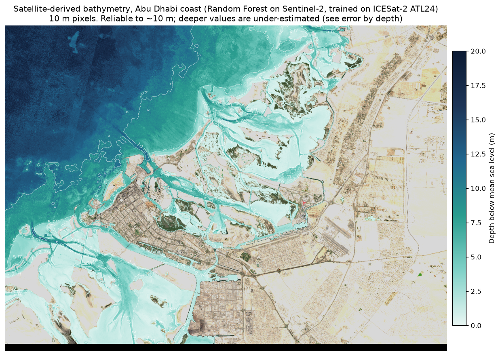
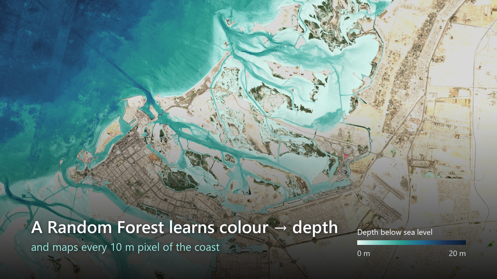
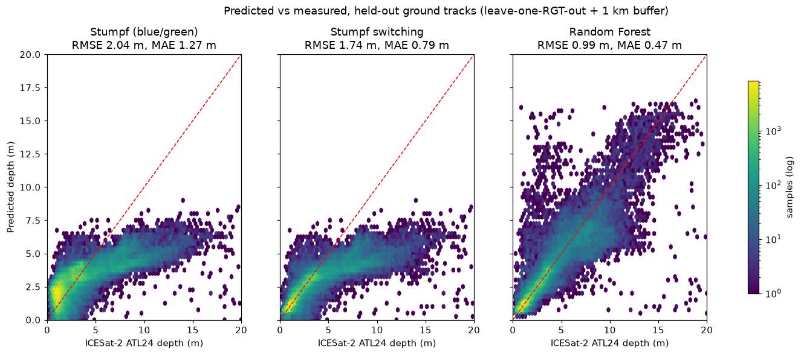
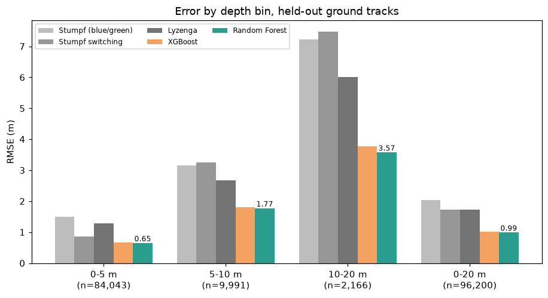
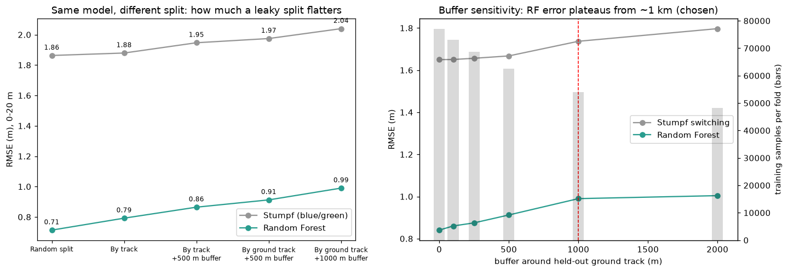
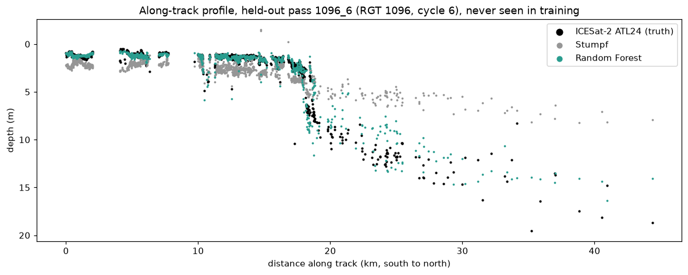
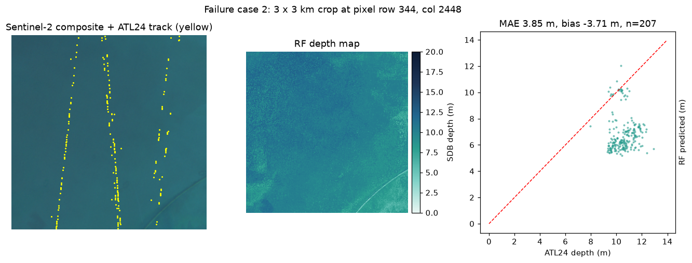
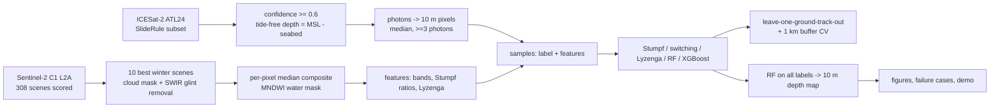

# Abu Dhabi Coastal Bathymetry: satellite-derived depth from Sentinel-2 + ICESat-2

**One line:** a 10 m shallow-water depth map of the Abu Dhabi coast, made only from free
satellite data. Sentinel-2 images give the colour of the water, and NASA's ICESat-2 laser depths
(ATL24) are the ground truth. On ICESat-2 ground tracks the model never saw, a Random Forest
reaches **RMSE 0.99 m / MAE 0.47 m / R² 0.84** over 0–20 m. The classic Stumpf method gets
RMSE 2.04 m / R² 0.32.



**22-second video overview:** [Video/abu_dhabi_bathymetry_overview.mp4](Video/abu_dhabi_bathymetry_overview.mp4)

[](Video/abu_dhabi_bathymetry_overview.mp4)

---

## 1. Problem

Ports, shipping lanes, dredging and coastal planning all need to know how deep the water is.
Ship and airborne surveys are expensive, slow, and quickly out of date on a coast that is
constantly reclaimed and dredged like Abu Dhabi's. Sentinel-2 sees the whole coast every
~5 days for free, and in clear shallow water the seabed shows through, so the colour of the
water carries depth information.

**Why it matters:** bathymetry is the base layer for maritime and port intelligence: a
depth map tells you where a vessel of a given draft can and cannot go. The demo turns the map
into exactly that ("draft clearance").

**The research question:** can we calibrate optical SDB with *space-borne* labels only
(ICESat-2 ATL24, no boat survey), and how good is it when evaluated honestly on tracks the
model never saw?

## 2. Research (summary of [docs/RESEARCH.md](docs/RESEARCH.md))

| Topic | What I took from it |
|---|---|
| Light in water (Pope & Fry 1997; Hale & Querry 1973) | Blue/green penetrate tens of metres, red ~2 m, NIR ~0.2 m, SWIR-1 ~1.5 mm. So blue/green carry depth, red helps only in very shallow water, and SWIR is the clean glint estimate. |
| Stumpf et al. 2003 | Log-ratio ln(nB)/ln(nG) is linear-ish in depth and robust to bottom type. The standard baseline. |
| Lyzenga 1978/1985 | ln(R − R∞) is linear in depth; multi-band regression. Best of the classic methods in Thomas et al. 2021. |
| Caballero & Stumpf 2019/2020 | Sentinel-2 SDB; red-ratio "switching" model for very shallow water; remove optically deep pixels. |
| ICESat-2 / ATL24 (Parrish 2019; Magruder 2025; NSIDC user guide 2026) | Green laser, refraction-corrected seabed photons classified by an ensemble of 6 algorithms; reaches up to ~40 m in clear water. |
| Thomas et al. 2021 | Fully space-borne SDB: ICESat-2 calibrates Sentinel-2. This is my blueprint. |
| Sagawa 2019; Gafoor 2022 (Abu Dhabi); ISPRS 2024 | Tree ensembles beat linear SDB. Gafoor: Sen2Cor is the best atmospheric correction here, **tide is the main error source**, random 70/30 split. |
| Roberts 2017; Ploton 2020 | Random splits over-state accuracy for spatial data; use blocked/grouped CV. |

## 3. Model choices

| Picked | Rejected | Why |
|---|---|---|
| **Random Forest** (final map) | — | Best on every depth bin under the strict split (0.99 m), robust to hyper-parameters, conservative at depth. |
| XGBoost (comparison) | as final | Within noise of RF (1.02 m), more knobs to tune. |
| Stumpf log-ratio (baseline) | — | The industry-standard reference: the ML model must beat it. |
| Stumpf switching + Lyzenga (stronger classic baselines) | — | So "ML beats a weak baseline" is not the story. Switching is excellent in 0–5 m (0.87 m). |
| 12 physics-informed features, **no coordinates** | lat/lon features | Coordinates let a model memorise neighbourhoods along the label tracks (leakage). |
| — | CNN / U-Net | Need dense labels; ICESat-2 gives thin lines. Next step. |
| — | Geospatial foundation model (Prithvi etc.) | Trained on land; overkill for 12 numbers per pixel on a 4 GB GPU. |
| — | Depth-balanced weighting | Tried: deep bias better, shallow worse, overall unchanged (D21). |

## 4. Build vs reuse

- **Reused (pre-trained / pre-processed by experts):**
  - NASA's **ATL24 classifier ensemble** (CoastNet CNN, Quantile-Trees XGBoost, BathyPathFinder,
    OpenOceans, ...) and its refraction correction. This is in effect a pre-trained model I
    use instead of classifying raw ATL03 photons myself. It was built on hundreds of labelled
    tracks, which I could not match in a week.
  - ESA **Sen2Cor** atmospheric correction (best for Abu Dhabi per Gafoor et al. 2022).
  - Published physics: Stumpf ratios, Lyzenga transforms, SWIR glint removal.
- **Built myself:** tide-free labelling, photon→pixel aggregation, scene scoring, glint-corrected
  multi-date composite, water mask, the switching baseline, leakage-aware evaluation (grouped
  CV + buffer + sensitivity + variogram), map prediction, figures, demo.
- **Why no pre-trained depth model:** none exists for Sentinel-2 → Gulf depth. Generic image
  backbones expect dense labels and spatial patches; this is a 12-feature tabular problem with
  96k labels, where tree ensembles trained from scratch take minutes on a laptop CPU and are
  the strong default.

## 5. Data

| Source | What | How |
|---|---|---|
| ICESat-2 **ATL24 v002** | 862,202 seafloor photons, 102 passes, 7 ground tracks, 2018-10 → 2024-11 | SlideRule Earth (server-side subset, no login) instead of 16.6 GB of granules |
| Sentinel-2 **L2A Collection-1** | 10 best of 308 clear scenes (2019–2024), tile 40RBN | Earth Search STAC, COG windows (1.3 GB) |
| GMRT / GEBCO | regional reference, ~460 m native | GMRT GridServer |

**Preprocessing** (details: [docs/TECHNICAL_EXPLAINER.md](docs/TECHNICAL_EXPLAINER.md), decisions D01–D25 in [DECISIONS.md](DECISIONS.md)):
1. ATL24 photons with confidence ≥ 0.6 → **tide-free depth** = local MSL − seabed height. Repeat
   passes over the same pixel now agree to 0.10 m (median) instead of 0.34 m.
2. Photons → 10 m Sentinel-2 pixels per pass (median, ≥ 3 photons, MAD ≤ 0.5 m) → 97,730 samples.
3. Scenes scored for cloud, glint (B11) and turbidity (red). Best 10 (all winter) → per-scene cloud
   mask + **SWIR glint removal** → **per-pixel median composite**.
4. Water mask: MNDWI > 0, ≥ 3 clear scenes, connected water body ≥ 0.1 km².
5. Features: 5 bands, Stumpf ratios (blue/green, blue/red, coastal/green), 4 Lyzenga terms.
   Validity rule ln(1000·R) > 0 applied to all models → **96,245 samples**, 96,200 in 0–20 m.

**Splits:** primary = **leave-one-ground-track-out** (all cycles of an RGT held out together) with
a **1 km buffer** (training pixels within 1 km of any test pixel removed). 5 folds, so every sample is
predicted once by a model that never saw its track or its surroundings.

## 6. Results

All numbers: `results/metrics_primary.csv`, `results/summary.json` (produced by `src/train_eval.py`
and `src/make_figures.py`).

**Held-out ground tracks, 0–20 m (n = 96,200):**

| Model | RMSE (m) | MAE (m) | Bias (m) | R² |
|---|---|---|---|---|
| Stumpf (blue/green) | 2.04 | 1.27 | −0.14 | 0.32 |
| Stumpf switching (red/green) | 1.74 | 0.79 | −0.57 | 0.51 |
| Lyzenga | 1.73 | 0.99 | −0.13 | 0.51 |
| XGBoost | 1.02 | 0.48 | −0.07 | 0.83 |
| **Random Forest** | **0.99** | **0.47** | −0.08 | **0.84** |

**RMSE by depth bin:**

| Model | 0–5 m (n=84,043) | 5–10 m (n=9,991) | 10–20 m (n=2,166) |
|---|---|---|---|
| Stumpf | 1.49 | 3.16 | 7.22 |
| Stumpf switching | 0.87 | 3.26 | 7.46 |
| Lyzenga | 1.28 | 2.66 | 6.00 |
| XGBoost | 0.66 | 1.80 | 3.76 |
| **Random Forest** | **0.65** | **1.77** | **3.57** |

**Experiments that support the design:**

| Question | Result |
|---|---|
| How much does a leaky split flatter? (RF RMSE) | random 0.71 → by pass 0.79 → pass + 500 m 0.86 → RGT + 500 m 0.91 → **RGT + 1 km 0.99** |
| Which buffer? | RF error plateaus from ~1 km (0.99 at 1 km, 1.00 at 2 km); the RF/baseline ratio is ~0.5–0.57 at every buffer |
| Composite vs best single scene (same 92,493 pixels) | RF 0.996 vs 1.085; Stumpf 1.93 vs 2.44: the composite wins for every model |
| Physics features vs raw bands (RF) | physics only 0.989, bands only 1.044, all 0.990 |
| Most important features | blue/green ratio (0.42), blue/red ratio (0.18), then much smaller |
| Depth-balanced weights | 10–20 m bias −2.10 → −1.25 m, but 0–5 m RMSE 0.65 → 0.75: not adopted |
| Tide-free labels | repeat-pass disagreement 0.34 → 0.10 m (median) |
| Independent check vs GEBCO grid | r = 0.91, median abs. difference 1.27 m (310,588 cells) |

| | |
|---|---|
|  |  |
|  |  |

**Failure cases** (`results/failures/`): the six 3 × 3 km areas with the largest errors are all
9–11 m deep, and the model predicts ~6 m there (bias −2.8 to −3.7 m). Two causes are visible:
- **Optical depth limit:** at ~10 m in Gulf water little light comes back from the bottom, so the
  ratios flatten and every optical method regresses towards the middle.
- **Label noise:** some ATL24 points in uniformly deep-looking water read 2–4 m, likely water-column
  returns classified as seafloor.

Per-pass offsets explain only 11.6 % of the error variance; they follow the pass's depth (r = −0.44)
and only weakly its tide (r = +0.16). The error map also shows a **composite seam** in the NW, where
the number of scenes in the median changes at the swath edge.



## 7. Limitations and next steps

- **Reliable to ~10 m.** Beyond that RMSE is 3.6 m and depth is under-estimated (conservative for
  navigation, but not usable as a chart). Only 2 % of labels are deeper than 10 m.
- **Not a navigation chart:** a typical error of ~0.5–1 m is far from IHO S-44 survey orders. Use it for
  screening, planning and change detection.
- **Time mismatch:** labels 2018–2024 vs images 2019–2024 on a coast with active dredging and
  reclamation; seabed change becomes "error".
- Small residual tide effect (Sentinel-2 dates have their own tide; r = +0.16 per pass).
- Composite seam at the swath edge; east edge has only 2 scenes (mostly land).
- Hyper-parameters fixed a priori (no nested tuning).
- One region; transfer to other Gulf coasts is untested.

**Next steps:** (1) fill the swath edge with same-date tile 39RZH; (2) tide-normalise each Sentinel-2
scene with a tide model; (3) a patch-based CNN trained on ICESat-2 lines with a masked loss to
use spatial context; (4) an uncertainty map (quantile regression forest) so users see where the map
is guessing; (5) monthly maps for **change detection** around ports and dredged channels; (6) test
transfer to Dubai/Ras Al Khaimah tracks.

## Pipeline



## Setup and run (Windows, Python 3.12; ~16 GB RAM, no GPU needed)

```bash
py -3.12 -m venv .venv
.venv\Scripts\activate
pip install -r requirements.txt
python src/run_all.py            # whole pipeline, ~1.5 h (scene scoring ~40 min is the slow part)
python src/run_all.py --from eval_primary   # resume from any step
streamlit run demo/app.py        # demo
python -m pytest -q              # unit tests
```
No accounts or API keys are needed. Data download details are in [data/README.md](data/README.md).
The steps run one at a time so the laptop's RAM is freed between steps.

## Repo layout

```
├── README.md, DECISIONS.md, PHASE0_REPORT.md
├── aoi/abu_dhabi_coast.geojson
├── data/README.md                 (raw data not in git)
├── docs/  RESEARCH · TECHNICAL_EXPLAINER
├── src/   download_atl24 · prepare_atl24 · check_tide_consistency · select_scenes · download_s2 ·
│          build_composite · features · extract_samples · train_eval · buffer_sensitivity ·
│          variogram · predict_map · make_figures · download_gebco · run_all · common
├── results/  metrics_*.csv · oof_*.parquet · summary.json · buffer_sensitivity.csv · variogram.csv ·
│             tide_consistency.json · figures/ · failures/ · depth_rf.tif · models/
├── demo/app.py
├── tests/test_core.py             (python -m pytest -q)
└── Video/abu_dhabi_bathymetry_overview.mp4 · .jpg (22 s video overview)
```
