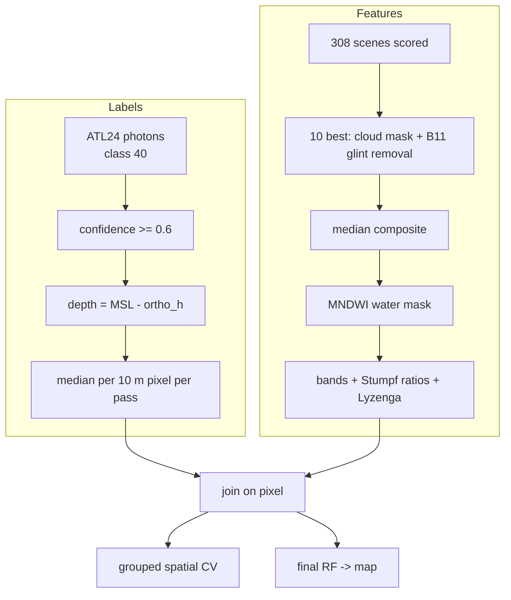

# Technical explainer: Abu Dhabi Coastal Bathymetry

How every part works and why it was chosen. Each section starts in **plain language**, then goes
into **technical depth**. Numbers are from `results/` (decision IDs refer to `DECISIONS.md`).

---

## 0. The whole project on one whiteboard

**Plain:** Shallow water looks lighter and more turquoise; deep water looks darker blue. A satellite
camera (Sentinel-2) sees this colour everywhere, but does not know the depth. A satellite laser
(ICESat-2) measures depth very precisely, but only along thin lines. I teach a model to translate
*colour → depth* using the places where both exist, then apply it to every water pixel.

```
 ICESat-2 laser (ATL24)                 Sentinel-2 camera (L2A)
 precise depth, thin lines              colour of every 10 m pixel, no depth
          |                                        |
  tide-free depth below MSL           10 clear winter scenes, glint removed,
  photons -> 10 m pixels              median composite, water mask
          |                                        |
          +---------> 96k matched pixels <---------+
                     (depth label + 12 colour features)
                              |
        Stumpf / Lyzenga (physics)   vs   Random Forest / XGBoost (ML)
                              |
      evaluate on ground tracks never seen (+1 km buffer)
                              |
          Random Forest on all labels -> 10 m depth map (12.9 M pixels)
```



---

## 1. Why colour tells you depth (the physics)

**Plain:** Water swallows light, and it swallows red much faster than blue. Light has to go down to
the seabed and back up. In shallow water, plenty of green and some red come back, so the water looks
bright turquoise. In deeper water, the green and red are mostly swallowed and only blue survives, so
it looks dark blue. Comparing two colours tells you how much water the light went through.

**Technical:** Pure-water absorption a(λ): 443 nm 0.007 m⁻¹, 490 nm 0.015, 560 nm 0.062, 665 nm 0.43
(Pope & Fry 1997), ~850 nm 4.3, ~1600 nm 672 m⁻¹ (Hale & Querry 1973). The bottom-reflected signal
decays roughly as exp(−2·K·z). Taking the log of two bands and dividing (Stumpf) cancels much of the
bottom brightness, because both bands see the same bottom, leaving a quantity that changes with z.
In my data the blue/green ratio rises from 0.944 (0–1 m) to 1.10 (15–20 m). The blue/red ratio rises
fast from 1.09 to 1.80 between 0 and 5 m, then saturates: red is gone after a few metres.

**Limits:** turbidity (sediment scatters light back before it reaches the bottom), dark bottoms
(seagrass looks deep), and the optical depth limit: past ~10 m here almost no bottom signal returns.

---

## 2. The labels: ICESat-2 ATL24

**Plain:** ICESat-2 fires 10,000 green laser pulses a second. Most photons bounce off the water
surface, but in clear shallow water some reach the seabed and come back a little later. From that
delay you get depth. NASA's ATL24 product already did the hard part: it decided which photons hit
the seabed and corrected for light bending and slowing down in water.

**Technical:**
- 6 beams (3 strong/3 weak), ~11 m footprints, ~0.7 m apart along track. 91-day repeat; 1,387 reference
  ground tracks (RGTs). At low latitudes the satellite off-points, so repeat passes of an RGT are not
  on the same line: in my AOI one RGT's passes spread over ~30 km and interleave with other RGTs.
- ATL24 classes each photon with a **stacking ensemble** (CoastNet CNN, BathyPathFinder graph method,
  OpenOceans GMM, Median Filter, Quantile Trees XGBoost, C-SHELPh), blunder checks and, in v002, a
  density step. `confidence` is the ensemble's output; `low_confidence_flag` = confidence < 0.6.
- **Refraction** is already applied (n from a temperature/salinity grid, Dietrich & Parrish 2025).
  Uncorrected, the seabed would appear ~25 % too deep (1 − 1/1.34). I do not apply it again.
- **Access:** 132 granules (~16.6 GB) cross the AOI. SlideRule Earth subsets them on the server: I
  download only class-40 photons inside the box (~45 MB), no login.

**What I got:** 862,202 photons, 102 passes, 7 RGTs, 2018-10 → 2024-11. After the confidence filter:
784,213.

---

## 3. Making the labels tide-free (the most important preprocessing step)

**Plain:** The depth ATL24 reports is "how far below the water surface at that moment". But the water
surface goes up and down with the tide. Here the surface at the different passes ranged from 1.2 m
below to 0.8 m above average, while half of all points are shallower than 1.5 m. So half the "depth
signal" would actually be tide. The seabed, however, does not move. So I measure the seabed's height,
work out where average sea level is, and define depth as *average sea level − seabed height*.

**Technical:**
- `ortho_h` = seabed height above the EGM08 geoid (tide-independent).
- Local MSL = median over passes of the per-pass median `surface_h` = **+0.461 m** (EGM08). 95 passes
  sample random tide phases, so this estimates mean sea level without an external tide model.
- depth = MSL − ortho_h.
- **Validation:** 10,561 pairs of different passes over the same 10 m pixel. Median disagreement:
  instantaneous depth 0.34 m → tide-free 0.10 m (RMS 0.61 → 0.43 m). `src/check_tide_consistency.py`.
- Why not a tide model (FES2014/TPXO)? It adds a dependency and is weakest exactly in complex shallow
  lagoons like Abu Dhabi's.

---

## 4. From photons to pixels

**Plain:** Many photons fall inside one 10 m image pixel. I take their median depth, require at least
3 photons that agree with each other, and drop lonely outliers (some "seabed" photons were actually
on the mainland).

**Technical:** project to UTM 40N (the Sentinel-2 grid), group by (pass, row, col), keep n ≥ 3 and
MAD ≤ 0.5 m, 0 < depth ≤ 30 m. 192,775 cells → 97,730 samples (88,894 unique pixels). One sample per
pass and pixel, so passes stay independent for splitting.

---

## 5. The imagery: Sentinel-2 composite

**Plain:** One satellite photo can have waves that sparkle (glint), haze, boats or murky water. So I
scored 308 clear photos for sparkle and murkiness, took the 10 best, removed the sparkle from each,
and for every pixel took the middle value of the 10. That gives one clean, calm picture.

**Technical:**
- **Collection-1** (`sentinel-2-c1-l2a`): whole archive reprocessed with baseline 05.xx. The older
  collection mixed baselines (blue water reflectance ~5× different) and had an offset trap that gave
  negative reflectance. Scale/offset are read from each asset's metadata (D07, D08).
- **Scene scoring** on 80 m COG overviews (~1 MB/scene): cloud/shadow fraction (SCL), glint = median
  B11 over water, turbidity = p75 of red over water. Resumable (D10).
- **Selection:** < 1 % cloud in the covered part, normal coverage, rank-sum of glint + turbidity.
  All 10 picks are winter (low sun, calm, clear).
- **Glint removal: R − R_B11.** SWIR-1 penetrates ~1.5 mm of water, so over water it measures only
  surface reflection + haze, which is almost wavelength-independent. The classic Hedley method uses NIR,
  but NIR still sees bright sand under < 0.5 m of water: it would subtract real depth signal where
  most of my labels are (D12).
- **Median composite** per pixel, plus a single-scene version for comparison (D13).
- **Water mask:** MNDWI = (G − SWIR1)/(G + SWIR1) > 0, ≥ 3 clear scenes, connected body ≥ 0.1 km²
  (removes ~60,000 speckles of wet salt flat inland) (D14).

---

## 6. Features

**Plain:** For each pixel the model gets 12 numbers: the five colours, three "colour ratios" from the
classic depth formula, and four "how much darker than deep water" values from the other classic formula.
It does **not** get the location, otherwise it could memorise "this neighbourhood is 3 m deep".

**Technical:**
- Bands B01 (443), B02 (490), B03 (560), B04 (665), B08 (842), glint-corrected reflectance.
- Stumpf ratios ln(1000·Ri)/ln(1000·Rj): blue/green, blue/red, coastal/green.
- Lyzenga terms ln(Ri − R∞,i) for B01–B04; R∞ = 5th percentile of water reflectance (D15).
- **Validity rule:** the log-ratio needs ln(1000·R) > 0, i.e. R > 0.001. Without it, near-zero pixels
  gave ratios from −16 to +19 and the linear Stumpf fit had R² ≈ 0 (although Spearman ρ = 0.69).
  The rule removes 459 samples (0.5 %) for **all** models; undefined red/coastal ratios become NaN,
  which trees handle (D16).

---

## 7. The models

**Plain:** Two physics formulas with a couple of fitted numbers (the classic way), and two machine-
learning models that can learn curved and combined relationships.

| Model | How it works | Fitted parameters |
|---|---|---|
| Stumpf | depth = m1 · ratio(blue/green) − m0 | 2 |
| Stumpf switching | blue/red model where it is shallow (< 2 m), blue/green where deeper (> 4 m), blend between; red only used where red > 0.01 | 4 |
| Lyzenga | linear regression on 4 log terms | 5 |
| Random Forest | 300 trees, each on a bootstrap sample, min 5 samples per leaf, 50 % of features per split; average of trees | trees |
| XGBoost | 800 boosted trees, depth 6, learning rate 0.03, subsampling 0.8 | trees |

**Why RF/XGBoost:** a tabular problem (12 numbers per pixel, 96k samples) where tree ensembles are the
strongest standard tool. They capture the non-linearity (the flat blue/green ratio in 0–2 m, red
saturating at 5 m) and interactions (bottom type × depth) that a 2-parameter line cannot. They train in
minutes on a CPU.

**Why not deep learning:** CNNs exploit spatial context but need dense label images; ICESat-2 gives thin
lines. No pre-trained Sentinel-2 depth model exists for the Gulf. Next step: a patch CNN with a masked
loss only on labelled pixels.

**Hyper-parameters:** fixed in advance (typical values) and not tuned on the test folds. Tuning inside a
spatial CV properly requires nested CV; RF is known to be insensitive to them.

---

## 8. Evaluation design: why the split matters

**Plain:** If I hide random points for testing, their neighbours 10 m away are in training with almost
the same colour and depth. The test then measures copying, not mapping. So I hide **whole laser ground
tracks** (all their passes), and also throw away training points within 1 km of the hidden track. Then
the test really is "map a place you have not seen".

**Technical:**
- 5 folds = the 5 RGTs with data (RGTs 1210/1271 have < 10 samples and stay in training only).
- Buffer: drop training samples within B m of any test sample (KD-tree).
- Measured leakage (RF RMSE): random 0.71 → by pass 0.79 → pass + 500 m 0.86 → RGT + 500 m 0.91 →
  **RGT + 1 km 0.99 m**. A random split looks ~28 % better than reality.
- Buffer sweep (0–2,000 m): RF error rises then **plateaus at ~1 km** (0.99 → 1.00). The variogram of
  depth keeps rising to 5 km (broad banks), so spatial dependence never fully disappears; beyond 1 km we
  mostly just lose training data (54k → 48k per fold). Importantly, RF is ~0.5–0.57× the baseline error at
  every buffer, so the conclusion does not depend on this choice.
- Every sample is predicted exactly once by a model that never saw its ground track (out-of-fold).

```
 RGT 151 | RGT 326 | RGT 593 | RGT 768 | RGT 1096     <- each fold holds out one ground track
   test  |  train  |  train  |  train  |  train
         <-1 km->   training pixels this close to the test track are removed
```

---

## 9. Metrics

- **RMSE:** penalises big errors; the standard in SDB papers. **MAE / median AE:** typical error.
- **Bias:** mean signed error (negative = predicted too shallow). It matters for safety: predicting too
  *deep* is the dangerous direction for a ship.
- **R²:** comparable with the literature.
- **By depth bin** (0–5, 5–10, 10–20 m): 87 % of samples are < 5 m, so an overall number hides deep
  performance.

---

## 10. Results in one breath

RF: RMSE 0.99 m, MAE 0.47 m, R² 0.84 (Stumpf: 2.04 / 1.27 / 0.32). By depth, RF gets 0.65 / 1.77 / 3.57 m
and Stumpf 1.49 / 3.16 / 7.22 m. Composite beats single scene for every model (RF 0.996 vs 1.085 on the
same pixels). Physics features alone = all features (0.989 vs 0.990); raw bands alone 1.044. The most
important feature is the blue/green ratio (permutation importance 0.42), then blue/red (0.18).
Independent GEBCO check: r = 0.91.

---

## 11. Failure modes (and what they teach)

1. **Optical depth limit:** all six worst areas are 9–11 m deep and the model predicts ~6 m. No light,
   no signal: ML cannot invent information that is not in the pixel. It only fails *less badly* than
   the linear formulas (bias −2.1 vs −7.0 m in 10–20 m).
2. **Label noise:** ATL24 points reading 2–4 m in uniformly deep-looking water, likely water-column
   returns classified as seabed. Part of the "error" is in the truth.
3. **Per-pass offsets:** 11.6 % of error variance is a constant offset per pass, driven by the pass's
   depth range (r = −0.44) and only weakly by tide (r = +0.16).
4. **Composite seam:** where the number of scenes in the median changes at the swath edge.
5. **Tried and rejected:** depth-balanced weights (deep better, shallow worse, D21); 0.5th-percentile
   R∞ (negative); NIR-based water mask (fails over bright shallow sand).

---

## 12. How it would run in production

- Weekly/monthly: new Sentinel-2 scenes → score → rolling composite → predict with the trained model →
  depth map + uncertainty → **change detection** (dredging, sedimentation, reclamation).
- Re-calibrate when new ATL24 releases add tracks (a few times a year).
- Serve as a raster layer next to vessel tracks and port imagery:
  e.g. flag a vessel whose draft does not fit the water it reports being in.
- Cost: training the final RF and predicting all 12.9 M water pixels (`src/predict_map.py`) runs in
  under 10 minutes on my laptop CPU (no GPU).
